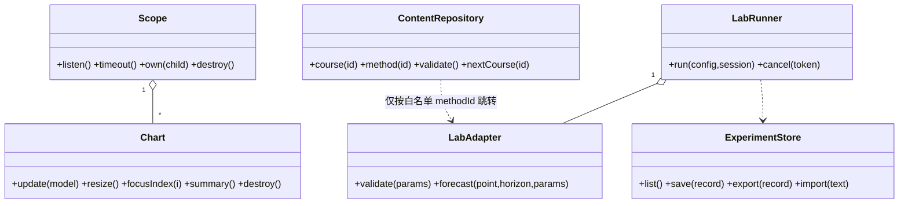
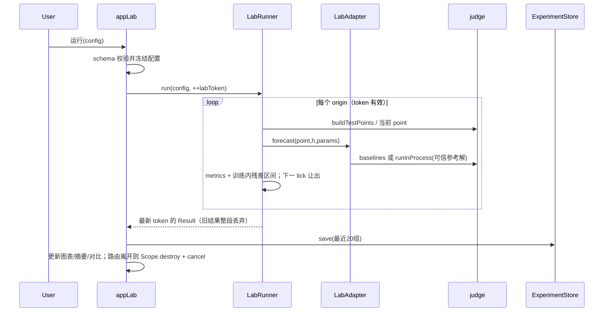

# TSOJ v3.0 系统架构与施工设计

## 0. 架构结论（取舍）
1. 延续 `window.TSJ`、IIFE、经典 script 与现有构建器，不引入框架、ESM、npm、网络资源或运行时编译。
2. `app.js` 只保留启动与判题装配；新增路由表、统一 `Scope` 销毁协议，页面返回句柄而非各自暗存全局监听。
3. 旧判题引擎与 DOM 选择器作为兼容底座；新功能放独立命名空间，禁止为换皮改写判题语义。
4. 图表采用统一 `Chart` 实例管理 DPR、resize、指针/键盘、摘要和销毁；旧 `drawSeries` 保留适配层。
5. 实验室直接复用 `judge.baselines/buildTestPoints/metrics/runInProcess` 和题目参考实现；不复制第二套 SES/Holt/AR 等算法。
6. 参数化参考实现仅做“精确锚点替换 + 失败关闭”，任何锚点漂移都阻止运行并报警，不用宽松正则猜参数。
7. 内容采用 `methods + methodDetails + courses + references` 关联扩展，29 卡字段不复制；公式用安全纯文本，不引入 MathJax。
8. 先交付确定性主线程受控实验，逐 origin 让出主线程并可取消；重型 Worker 属 P2，不在本期增加沙箱分支。

## 1. 文件树与职责
`M`=修改，`A`=新增；所有 JS/CSS 文件目标 ≤400 行，超限按纯函数/视图继续拆。
```text
M index.html                         新导航、主题控件、CSS/JS 有序清单；CSP 原样保留
M assets/css/style.css               旧选择器兼容层，不改名；逐步以 token 替换硬编码色
A assets/css/tokens.css              色彩/字号/8px 间距/圆角/阴影/图表语义色、light/dark 变量
A assets/css/components.css          ds-* 控件、表单、空错载态、焦点、触控、reduced-motion
A assets/css/pages-v3.css            wk-/course-/md-/lab-/chart-v2 布局与 375/768/1440 网格
A assets/js/content/references.js    TSJ.references：一手来源、URL、核查日期、出版状态
A assets/js/content/courses.js       TSJ.courses：8 模块正文、先修、演示、练习、产出
A assets/js/content/method-details.js TSJ.methodDetails：按 methodId 扩展，不复制卡片字段
A assets/js/content/content.js       TSJ.content：索引、先修图、查询、三级运行标签与完整性检查
A assets/js/charts/core.js           TSJ.charts.create：生命周期、比例尺、几何、空态、降采样
A assets/js/charts/series.js         历史/真值/预测/基线/区间/残差/对比图
A assets/js/charts/diagnostics.js    ACF/PACF、季节分解及诊断专用几何
A assets/js/lab/config.js            TSJ.labConfig：白名单 schema、默认值、校验、稳定序列化
A assets/js/lab/adapters.js          TSJ.labAdapters：基线与参考解唯一适配层、参数锚点清单
A assets/js/lab/stats.js             残差、ACF/PACF、分解、经验区间、滚动汇总纯函数
A assets/js/lab/runner.js            TSJ.labRunner：确定性执行、会话令牌、分片、取消、预算
A assets/js/app/lifecycle.js         TSJ.appLifecycle：Scope、listen/timer/observer/child/destroy
A assets/js/app/theme.js             system/light/dark 解析、持久化、matchMedia 解绑
A assets/js/app/dashboard.js         #/ 工作台，真实进度/最近实验/继续学习
A assets/js/app/learn.js             #/learn 与 #/learn/:id、课文/练习/先修
A assets/js/app/method-detail.js     #/methods/:id、公式/反例/引用/实验与题目出口
A assets/js/app/lab-storage.js       最近 20 组、校验导入导出、失败不覆盖
A assets/js/app/lab.js               #/lab 配置、运行、对比、诊断视图
M assets/js/app.js                   查表路由、统一销毁；判题函数原样迁移时不得改语义
M assets/js/app/{core,store,schema,storage,boards,library}.js 新键/新页数据接口与互链
M assets/js/chart.js                 仅增加 v2 适配出口；旧 API/几何字段保持
M tools/build-standalone.js          多 CSS 已由通用正则支持，仅补清单/数量诊断，不改内联规则
M tests/qa/static.test.js            从 index 清单派生脚本审计，保持顺序/依赖/CSP 强断言
A tests/qa/{content,charts-v2,lab,theme}.test.js 数值、schema、边界、存储与确定性测试
A tests/qa/v3-browser.test.js        路由/旅程/响应式/键盘/销毁 50 次/standalone 浏览器验收
```
不修改 `datasets.js / problems.js / judge.js / editor.js`；旧 `views/problem/pages/ui/a11y` 仅在有测试证明必要时做兼容接线。

## 2. 加载顺序与单向依赖
```text
数据：datasets → problems → methods → content/references → content/courses
     → content/method-details → content/content
引擎：judge → editor → chart → charts/core → charts/series → charts/diagnostics
     → lab/config → lab/adapters → lab/stats → lab/runner
应用：app/util → core → schema → store → storage → lifecycle → ui → a11y
     → theme → views → problem → pages → dashboard → learn → method-detail
     → lab-storage → lab → library → boards → app.js（最后且同步 init）
CSS：tokens → style（legacy）→ components → pages-v3
```
依赖只允许向图中左侧；页面不得互相 import/调用，通过 `TSJ.app.navigate()` 或启动时注入回调解耦。引擎不得引用 `TSJ.app*`；`content/*` 不得引用图表、实验室或 DOM。静态测试读取上述单一清单并验证每个命名空间只引用更早模块，不能仅放宽旧白名单。

## 3. 路由、导航与状态
| Hash | 渲染入口 | 标题/异常与返回 |
|---|---|---|
| `#/` | `appDashboard.render` | 工作台；无 hash 首次进入这里，不再伪装成题库 |
| `#/learn` | `appLearn.renderMap` | 课程地图；先修与完成度 |
| `#/learn/:id` | `appLearn.renderModule` | 无效 ID 渲染可恢复错误并链接课程地图 |
| `#/lab` | `appLab.render` | 实验室；可用 `?method=&dataset=` 受控预设，未知值忽略并提示 |
| `#/methods` | `appLibrary.renderMethods` | 旧 29 卡、默认筛选与键盘行为不变 |
| `#/methods/:id` | `appMethodDetail.render` | 无效 ID `location.replace('#/methods')` 并提示，避免坏后退栈 |
| 旧 7 类 hash | 原入口 | `#/problems/#/problem/#/submissions/#/submission/#/ranking/#/path` 不迁移、不改名 |
路由切换顺序：旧 `editor/chartHover` 销毁 → `state.routeScope.destroy()` → `judgeToken++/abort` → `labToken++/cancel` → 关弹层 → 渲染 → 标题/滚动/`#view` 聚焦。返回链接使用真实 hash；同路由重渲染不重复绑定 window/document。
新键：`tsoj:theme=system|light|dark`、`tsoj:courseProgress:v1`、`tsoj:lab:v1`（含最近 20 组）、`tsoj:labDraft:v1`；全部集中在 `STORE`，逐字段归一化。失败时保留内存态、显示“仅本次会话有效”；损坏导入先完整校验再替换，旧进度包 schema=1 不变。

## 4. 核心数据结构与接口
```js
// Course：正文仅受控 Markdown；demo 指向注册表而非任意代码
{ id:'m2', title:'经典统计与诊断', prereq:['m1'], level:'L2',
  topics:['ETS','ACF/PACF'], body:'## …\n事实…[ref:fpp3]',
  formulas:[{id:'ses', text:'l_t = αy_t + (1-α)l_(t-1)', example:'…', variables:'…'}],
  demo:{kind:'sandbox', id:'decomposition'}, exercise:{problemIds:['p4-ses'], output:'残差诊断单'},
  counterexamples:['…'], referenceIds:['fpp3'] }
// MethodDetail：以 methodId 关联旧卡；runLevel 只能三选一
{ methodId:'deepar', intuition:'…', assumptions:['…'], complexity:'…', limitations:['…'],
  formulas:[], workedExample:'…', counterexample:'…', runLevel:'concept', referenceIds:['deepar-2020'] }
// Reference
{ id:'chronos-2024', title:'…', authors:'…', year:2024, venue:'arXiv', status:'preprint',
  url:'https://arxiv.org/abs/2403.07815', checkedAt:'2026-10-24' }
// LabConfig / ExperimentRecord
{ schema:1, datasetId:'airline', method:'holt-winters', params:{alpha:.32,beta:.06,gamma:.28},
  split:{mode:'rolling',horizon:12,windows:4,originStep:12}, metrics:['mse','mae','smape'],
  baseline:'seasonal_naive', interval:{enabled:true,levels:[80,95]} }
{ id:'…', schema:1, appVersion:'3.0.0', algorithmVersion:'lab-1', datasetVersion:'datasets-2.2',
  createdAt:0, config:{}, configHash:'8hex', metrics:{}, origins:[], baseline:{}, intervalMeta:{}, durationMs:0 }
```

`content.validate()` 检查 8/29 数量、ID/先修闭包、每课课文/演示/练习/来源、每方法公式小例/局限反例/运行标签、引用字段和 URL 白名单；核心事实须有就近 `ref:`，失败列出精确路径。

## 5. 图表 API 与边界
```js
var chart = TSJ.charts.create(canvas, {
  kind:'forecast', ariaLabel:'航空客运量预测', unit:'千人', height:280,
  onInspect:function(index){}, scope:routeScope
});
chart.update({ x:{type:'index',label:'观测序号'}, history:[], actual:[], prediction:[], baseline:[],
  intervals:[{level:80,lower:[],upper:[]},{level:95,lower:[],upper:[]}],
  splits:[{index:132,role:'test'}], notes:[], maxPoints:1200 });
chart.resize(); chart.focusIndex(0); chart.summary(); chart.destroy();
```
统一返回几何 `{xOf,yOf,indexAt,plot,domains,visibleSegments,sampleMap}`，tooltip 与键盘共用 `focusIndex`，摘要由同一模型生成；不再让交互猜绘制细节。颜色取自 `getComputedStyle` 的 `--chart-history/actual/prediction/baseline/interval`，真值实线圆点、预测虚线方点、基线点划线三角，不能只靠颜色。
空数组显示原因与下一动作；单点居中且禁止伪造斜率；常数域以 `max(1,abs(v)*.05)` 扩展并注明；NaN/null 断线并计缺失数，指标不静默插值；全非法值不画零线假数据。长序列仅显示层 min/max 桶降采样（保留极值/切分点），tooltip 可回原索引，计算与存储不降采样。ACF/PACF 标滞后、估计法和置信界假设；分解缺完整周期时拒绝；残差含零线；对比图共享协议/单位；区间从浅到深且显示经验覆盖率与 n。`destroy` 幂等，解绑 canvas/window/ResizeObserver/RAF，清 `__geom`；无全局逐图 resize 监听。

## 6. 实验室执行与诚实边界
- 白名单：`naive/seasonal_naive/mean/moving_average/ses/holt/holt-winters/ar/theta/dlinear`；Croston 课程演示若新增实现，放唯一 `lab/adapters` 注册项并同时服务课程，不宣称来自 p12（其参考解为 TSB）。
- `moving_average` 通过受控 `ctx.season` 复用 judge；其余基线直接调用。参考解适配器只允许固定 `problemId + 精确参数锚点`，用 `runInProcess` 执行可信源码；用户不能提交代码或表达式。
- 配置限制：horizon 1–48、rolling windows 1–12、originStep 1–48、参数有限且在注册范围；训练长度必须满足方法最小样本与校准长度。主指标 MSE/MAE/sMAPE 直接调 judge，显示口径与“越低越好”。
- 先冻结数据/配置，再由 `buildTestPoints` 生成 origins；每个 origin 只用其 `history`，候选与基线共享相同样本。逐 origin 检查 token 并 `setTimeout(0)` 让出；目标 <500ms，超 100ms 已显示忙碌，超预算拒绝新配置而非偷偷截断结果。
- 保存完整配置、版本、逐 origin 预测/真值/残差、指标和基线；相同输入数值深比较一致，时间戳不参与结果哈希。20 组按时间淘汰，写入失败不动旧盘值；导入限制 4MB、schema/app/hash/字段/数值全验。
- 区间仅从训练段内部校准残差构造 80%/95% 经验分位区间；测试真值绝不参与校准。UI 固定文案“残差经验区间 / 教学演示，非模型原生概率输出；边际覆盖不等于条件覆盖”，样本不足则不显示覆盖率承诺。


## 7. 内容渲染、设计系统与可访问性
Markdown 只允许标题、段落、列表、引用、行内/块代码、粗斜体及受控 `[ref:id]`；先 `esc` 再生成固定标签，禁 raw HTML、图片、任意链接/属性。公式以 `<pre class=md-formula>` 显示 Unicode/ASCII，定义符号、求和范围、零值处理并配数值小例，可局部横滚；外链只由 references 渲染 `rel=noopener noreferrer`。先修图由 `prereq` 派生，不手画第二份导航。
新组件统一 `ds-btn/ds-field/ds-badge/ds-card/ds-table/ds-empty`；业务前缀分别为 `wk-/course-/md-/lab-/chart-v2`。旧 `.btn/.chip/.mcard/.prow/.pcard/.ed-*` 等保留，兼容层优先，新增规则不得依赖更高特异性或 `!important` 压旧媒体查询。桌面 12 栏/max1280/padding32，768 为 8 栏，≤640 单栏/padding16；表格仅局部横滚。
`:root` 默认深色，`[data-theme=light]` 浅色，system 由 JS 解析并监听变化；初始化在首渲染前完成避免闪烁。正文 ≥16px、辅助 ≥12px、44px 触控、`:focus-visible`、reduced-motion 禁平滑/曲线动画；移动抽屉 Esc 关闭并恢复触发按钮焦点。每页一个 H1，图表毗邻文字摘要，状态同时有文字/形状。

## 8. 有序施工任务（同依赖组可并行）
| ID / 优先级 | 内容与文件 | 依赖 | 验收标准；受影响旧测试 |
|---|---|---|---|
| T01 P0 基础设施 | `index.html`、4 份 CSS、`app/lifecycle.js`、`app/theme.js`、`app.js`、`static.test.js` | 无 | 查表路由旧深链全通，Scope/主题可销毁，CSP 原样；更新脚本顺序与首屏默认断言，旧功能不断 |
| T02 P0 内容源 | `content/*`、内容测试 | T01；可与 T03/T04 并行 | 8 课/29 详情/引用/先修/运行标签 100% 完整，无重复卡字段；`library.test` 29 卡原断言不变 |
| T03 P0 图表内核 | `charts/*`、`chart.js` 适配、图表测试 | T01；可并行 | 六类图与空/NaN/常数/单点/长序列/键盘/destroy 通过；旧 tooltip 与 T08 不放宽 |
| T04 P0 实验引擎 | `lab/config|adapters|stats|runner.js`、`app/lab-storage.js`、lab 测试 | T01；可并行 | 同配置确定性、无泄漏、参数锚点失败关闭、20 组与损坏导入安全；158 数值判题断言全绿 |
| T05 P0 工作台 | `app/dashboard.js`、store/schema/storage、导航 | T01,T04 | 真实进度/最近实验/空态/存储失败可见；browser 首屏改为显式分别验证 `#/` 与 `#/problems` |
| T06 P0 课程 | `app/learn.js`、course CSS、内容演示接线 | T02,T03,T04 | 8 课正文—演示—练习—产出—下一课闭环；path 深链与进度不迁移 |
| T07 P0 实验室 UI | `app/lab.js`、lab CSS、诊断/对比/导入导出 | T03,T04 | 配置→运行→诊断→保存→刷新恢复，取消/迟到回调不污染；三档无横溢 |
| T08 P0 方法与互链 | `app/method-detail.js`、library/boards 兼容修改 | T02,T03,T04 | 29 详情与三级标签准确，方法→实验/题目→提交→下一课可走；原筛选 29/9/13 与键盘断言不变 |
| T09 P0 综合体验 | components/pages CSS、a11y 必要接线、v3-browser | T05–T08 | 375/768/1440、键盘/reduced-motion/主题对比、50 次路由重跑无累积；T07/T11 原断言保持 |
| T10 P0 冻结回归 | 全部测试、standalone 构建/校验、交付清单 | T09 | 原 158 + 新增 0 fail/0 skip（环境必须提供浏览器），单文件逐字一致且无请求；不改阈值来修红 |

## 9. 测试、性能与回滚
静态测试从真实 script 清单检查存在性、≤400 行、依赖方向、禁 ESM/CDN/Math.random/CSP 违规；内容测试额外核对事实引用与不可运行标签。数值测试以固定小例手算 ACF/PACF/分解/区间，验证 NaN 不进入分母、rolling 不越界；实验适配器默认参数须与对应参考解输出一致。浏览器测试覆盖后退/前进/标题/焦点、旧草稿与提交、导入配额、触控/键盘、50 次路由和重跑前后监听器/Worker/计时器计数。
首屏只渲染工作台摘要，课程长文/方法展开/诊断按需生成；不在启动时计算 15 题参考分。Canvas 每帧一次模型更新，resize 单 RAF 合并，显示层 min/max 桶至约 1200 点；实验记录有数量/大小上限。所有新计时器、observer、URL、worker 必须登记 Scope，destroy 幂等。
建议回滚点（仅设计，不执行 git）：T01 后 `v3-shell`、T04 后 `v3-engine`、T07 后 `v3-lab`、T09 后 `v3-rc`；按任务提交可独立 revert，T10 只修缺陷不回退验收。每批重新生成 standalone；若新路由异常，可回滚对应页面与路由项而保留旧七类路由。

## 10. 施工契约补充
### 10.1 Scope 与页面返回值
```js
var scope = TSJ.appLifecycle.createScope();
scope.listen(window, 'resize', onResize);       // 自动 removeEventListener
scope.timeout(fn, 120);                        // 触发后自动注销，destroy 可清理
scope.raf(fn);                                 // 同 key 只保留最新 RAF
scope.observer(new ResizeObserver(fn), target); // disconnect
scope.own(chart);                              // 调子对象 destroy
scope.cancel(function(){ labToken++; });        // 注册任意一次性清理
scope.destroy();                               // 幂等、逆序执行、清空数组
// 每个有副作用的 render 返回 { destroy: fn }；纯 HTML 页面也返回空 destroy，路由不猜类型。
```
`state.routeScope` 只拥有当前页资源；`state.judgeToken` 与新增 `state.labToken` 不合并，避免实验取消误伤判题。全局 storage/hashchange 各只有一个应用寿命监听，启动装配不重复执行。页面局部重绘必须先销毁旧子图再建新图，不能依赖 DOM 替换自动解绑 JS 监听。
### 10.2 方法注册表最小字段
| 字段 | 含义与校验 |
|---|---|
| `id/label/source` | 唯一 ID、显示名；`baseline` 或 `reference:problemId` |
| `defaults/constraints` | 默认参数；每个参数的 finite/min/max/step/整数约束 |
| `minHistory(ctx)` | 按季节、窗口与校准需求返回最小训练长度 |
| `anchors` | 参考源码中精确旧字符串；数量必须唯一，替换后仍须语法检查 |
| `runLevel` | 实验室条目只能 `sandbox`；预计算和概念级不得注册为可运行 |
| `diagnostics` | 声明可用残差/ACF/区间能力，不提供时显示原因而非空面板 |
参数表单由 constraints 派生，不接受任意键；URL 预设与导入同样经过 `normalizeConfig`，不能直接合并进默认值。稳定序列化递归排序键并拒绝 `undefined/NaN/Infinity`，保证哈希与导出可复现。
### 10.3 结果聚合口径
- 每个 origin 保存 `trainEnd/actual/prediction/baseline/residual`，指标同时保存逐 origin 与 pooled 结果；页面明确当前展示口径，不能混称。
- rolling 汇总默认先连接各 origin 的预测再算 pooled 指标，另给 origin 均值作敏感性参考；重复覆盖的未来点须标注重叠，不能伪装成独立样本。
- 参数前后对比固定 dataset/split/metrics/baseline，只变 params；若协议也变了，显示“不可直接归因于参数”。
- `durationMs` 只用于性能反馈，不进入 configHash；导入记录版本不兼容时只读展示或拒绝，不静默改算历史结果。
### 10.4 默认假设与待确认项
1. 本期 9 条数据均按等间隔索引处理，没有真实时间戳；所有图明确写“观测序号”，不补造日期。
2. 课程完成度只记录用户显式完成的练习/产出，不把滚动浏览当完成；不迁移旧题目通过记录。
3. 深度模型“预计算演示”必须随内容附带固定输入、输出与来源；没有可核查材料时降级为概念图，不生成貌似真实的数值。
4. 课程 8 的 Croston 与 p12 当前 TSB 参考解不同，实施前须按唯一 Croston 适配器验收；不得为凑可运行标签改 p12。
5. 外部引用 URL 是用户主动打开的阅读链接，不是应用资源请求；离线时正文仍完整，链接不可达不影响学习闭环。
6. 若实验在常规设备持续超过 500ms，优先减少窗口/参数上限并明示，不在 P0 临时引入不可取消的重 Worker。

## 11. 最高风险与不要动的部分
1. **判题冻结**：不得修改 `judge.js` 的 `metrics/baselines/scoreForRatio/buildTestPoints/scoreCase/buildReport`，不得改 15 题阈值/starter/solution 或 158 断言口径。
2. **兼容冻结**：不得删除旧 hash、29 卡默认行为、`.prow/.pcard/.mcard/.mc-title/.ed-*` 等测试选择器、旧 localStorage 数据与 `drawSeries/attachChartHover/__tsjGeom`。
3. **CSP/交付冻结**：meta 只能 `connect-src 'none'`，禁止 `'self'/default-src/script-src/style-src`；禁 ESM/CDN/远程字体，构建顺序不能破坏 srcdoc。
4. **算法漂移**：参数化参考解的锚点替换是最高风险，必须逐方法快照测试、失败关闭；不得复制算法或把 p12 的 TSB 冒充 Croston。
5. **泄漏与误导**：测试段不得用于拟合、校准、降采样统计或调参宣称；合成结果不外推，深度/基础模型只标概念级或预计算，残差区间不冒充原生概率。
6. **生命周期**：旧全局 chart resize 只能保留单例兼容；新页面禁止自挂匿名 window 监听。路由、存储同步与实验回调都必须验证 token 和已销毁状态。

## 12. v3.7 增量（相对 v3.0 蓝图）

> v3.0 文中「15 题 / 158 断言」是当时口径；当前为 **17 题 / 218 条 QA**。判题语义未变，以下只记新增面。

### 12.1 新增模块与依赖方向

| 模块 | 职责 | 依赖 | 被谁调用 |
|---|---|---|---|
| `app/studio-csv.js` | CSV 解析 / 列序嗅探 / 季节估计 / 本地恢复 | `app/core`（STORE、readJSON/writeJSON、esc） | `app/studio`（`setupPanel`） |
| `app/achievements.js` | 8 个成就定义、事件判定、解锁落盘 | `app/core`、`TSJ.problems`、`TSJ.methodsById` | `app.js`（判题）、`app/studio`（工坊）、`app/method-detail`（方法浏览）、`app/glossary`（术语查阅） |
| `app/studio-report.js#buildShareCard` | 自包含分享卡 HTML | 同文件 `paint`、`core.esc` | `app/studio`（分享按钮） |

依赖仍严格单向：`studio-csv` 不引用 `studio`，`achievements` 不引用任何页面模块。调用点全部有 `if (TSJ.appXxx)` 保护——成就/CSV 失败不得阻断判题主流程。

### 12.2 新增存储键

| 键 | 内容 | 上限 / 清理 |
|---|---|---|
| `tsoj:studioCsv:v1` | 最近一次上传的 `{values, name, season}` | 5000 点；重新上传覆盖；`remove()` 删除 |
| `tsoj:achievements:v1` | `{ [id]: 解锁时间戳 }` | 只增不减；幂等 |
| `tsoj:achMeta:v1` | `{ methods: string[], looks: number }` | methods 最多 60 条，looks 上限 9999 |

CSV 数据**不写入** `tsoj:datasets`（内置数据集是代码生成的只读内容）；运行时以 `id='my-csv'` 追加到 `TSJ.datasets`，刷新时由 `restore()` 重建。实验记录导出只含指标与代码指纹，不含数据本体。

### 12.3 pinball 指标的边界

- `judge.metrics.pinball(actual, predicted)` 的 **τ=0.95 固化在函数内**（指标签名没有第三参），P16 题面同步声明「95 分位备货」。
- 语义：`actual > predicted`（缺货）罚 `0.95×缺口`；`actual < predicted`（冗余）罚 `0.05×冗余`。它不是对称误差，不能与 MSE/MAE 横向比较。
- 基线（naive / seasonal_naive / mean / moving_average / linear_trend）仍是点预测，被直接当备货水平打分——这是 P16 的教学设计，不是实现缺陷。
- 其他题不得引用 `metric: 'pinball'`，否则 `solutions.test.js` 的「朴素解不可过」口径会失真。

### 12.4 分享卡的安全边界

- 所有动态字段（数据集名、代码指纹、阶段、拆分）一律过 `core.esc`；数据集名来自文件名，视为不可信输入。
- 图片用 `canvas.toDataURL` 内联为 `data:`，整张卡无外部资源，可离线打开、可邮件附件。
- 不含用户代码正文、不含 CSV 原始数值；只有指标、拆分、指纹与 `testRuns`。

### 12.5 浏览器测试的并发契约

`tests/qa/helpers/cdp.js` 的 `launch()` 内置全局文件锁（`os.tmpdir()/tsoj-cdp.lock`）：同一时刻只允许一个 headless 实例，其余测试进程排队等待。原因：8 个测试文件并发会 spawn 8 个 Chromium，把 `Runtime.evaluate` 拖过 20s 超时，产生成片假失败并污染页面状态。锁带 PID + 10 分钟陈旧检测，进程崩溃不会永久卡死。`--test-concurrency=1` 仍是推荐跑法，但不再是正确性的前提。

### 12.6 外生协变量：P17 的 `ctxExtra` 扩展点

P17（促销日历）是第一个需要「题目专属上下文」的题：它要求模型同时处理**历史促销污染**与**未来促销修正**，因此 `ctx` 里必须带 `promoDays`。但 `buildTestPoints` 的 `ctx` 四字段（`freq` / `season` / `datasetId` / `index`）被 `split.test.js` 用 `deepEqual` 钉死，**不能改**。

于是扩展点放在 `buildJobs` 层，而不是切分层：

```js
// problems.js —— 题目声明自己需要什么额外上下文
ctxExtra: function (point, dataset) { return { promoDays: dataset.promoDays || [] }; }
```

```js
// judge.js —— buildJobs 里浅合并到 ctx 副本，p.ctx 本身不被修改
var add = extra(p, dataset, problem);
ctx = merge(p.ctx, add);   // 新对象，不写回测试点
```

三条约束：

1. **`ctxExtra` 只能读数据集，不能读测试段真值**。它拿到的是 `(point, dataset, problem)`，`dataset.values` 包含完整序列——题面必须自己声明「只能用 `history` 与 `ctx`」，参考解不得碰 `dataset`（`solutions.test.js` 不检查这条，靠 code review）。
2. **合并顺序是 `p.ctx` 在前、`add` 在后**，题目可以覆盖四字段，但现有题都没有这么做；新增题若要覆盖 `index`，必须同步改 `split.test.js`。
3. **数据集生成器可以返回对象**：`datasets.js` 注册表接受 `build(rng) → number[] | {values, ...extra}`，对象形态下 `values` 必填，其余字段原样挂到 `ds` 上。P17 的 `retail_daily` 用它携带 `promoDays`（绝对下标，与 `history` 同一坐标系）。

数据设计上有一条硬约束：**测试窗口内必须同时存在历史促销日与未来促销日**。P17 让生成器在最后两周固定放 2 个促销日（`n-9`、`n-3`），否则「只清洗历史」或「只乘未来」的半成品解能过线——这是通过数据设计而非改评分解决的问题。实测梯度：模板 55 / 只清洗历史 44 / 只修正未来 54 / 参考解 100（通过线 60）。

### 12.7 事件标记与预览图契约

`chart.js` 只认一个通用入参，不认识「促销」这个概念：

```js
TSJ.drawSeries(canvas, {
  values, testStart, predictions,
  markers: { indices: [721, 727], label: '促销日' }   // 可选
});
```

题目侧用两个字段声明（`problems.js`）：`markerField: 'promoDays'` 指向数据集上的字段，`markerLabel: '促销日'` 决定图例与 tooltip 文案。**为什么不让 chart 直接读 `ctxExtra`**：`ctxExtra` 是按测试点计算的，而预览图画的是整条序列；标记必须来自数据集本身（全序列下标），否则 holdout 与 rolling 会画出不同的标记集。

两条实现约束：

1. **opts 必须只有一个来源**。初始绘制（`app/problem.js`）与跑完重绘（`app/views.js#paintPrediction`）共用 `TSJ.appViews.chartOpts(p, ds, predictions)`。历史上这两处各写一份 opts，加标记后「跑一次标记就消失」——已由 `v3-browser.test.js` 的「跑完预测后重绘：标记点仍在」守住。
2. **几何信息要带上标记索引**。`canvas.__tsjGeom.markers` 是 `{ [index]: 1 }` 的查找表，供 hover 层在 tooltip 首行加「促销日」；`__tsjChart.markers` 保留原始数组供测试与调试读取。

标记的绘制位置在折线之后、预测虚线之前：压在历史线上保证可见，又不会被预测虚线覆盖。颜色取 `--v3-warn`（深色 `#f5b942` / 浅色 `#b45309`），与三条线型图例（历史 / 真实值 / 预测）区分开。

### 12.8 文档口径的唯一来源

README 里的数字曾经是手写的，每加一道题就漂一次。现在口径只在一处计算：`tools/numbers.js#compute()`。

```bash
node tools/numbers.js     # 打印口径表 + 列出 README 里对不上的行号（不一致时 exit 1）
```

`tests/qa/docs-numbers.test.js` 复用同一个 `compute()` 与同一张 `CLAIMS` 表，把「数字一致」变成断言。三层结构：

| 层 | 职责 | 为什么这样分 |
|---|---|---|
| `compute()` | 从源码现算（加载 datasets / problems / methods / courses / glossary / lab config，解析 index.html 的 script 标签，统计 `tests/qa/*.test.js` 的 `^test(`，读单文件版体积） | 只算不改，可被工具与测试同时复用，不存在两份实现 |
| `CLAIMS` | 「哪句话里的数字应该等于哪个口径」的正则表 | 显式列出，不用宽泛匹配去猜，避免误报常量（如「最多 120 条提交记录」） |
| `checkReadme()` | 逐条比对，返回 `{claim, line, text, expected}` | 失败信息直接给行号与应有值，改完能自检 |

两条设计取舍：

1. **不做自动改写**。工具只报告，不改 README。正文里的数字嵌在句子里（「17 道题（入门→挑战）」），正则替换很容易把句子改坏；让人看一眼再改更安全。
2. **体积允许 ±3KB**。单文件版每次重建会浮动几百字节，精确相等会让每次构建都红。

用例数这一项有个自指问题：`docs-numbers.test.js` 自己也被计入。这是有意的——加测试就必须同步 README 的「N 条用例」，否则红。规则简单，代价是每次加用例要多跑一次 `node tools/numbers.js`。

### 12.9 分量序列与分量预览：P18 的 `parts` 契约

P18 要考「总量里藏了两个周期」，前提是分量**能被拿出来**。这条链路上有三处约定，缺一处就会静默失准：

| 环节 | 约定 | 违约后果 |
|---|---|---|
| `datasets.js` | `build(rng)` 可返回 `{ values, parts }`，`parts` 是 `[{ name, period, values }]`，与 `values` **等长**且**逐点相加等于 `values`** | 参考解看起来在跑，其实在拟合一条不存在的序列 |
| `problems.js#ctxExtra` | 按 `point.history.length` 截断每路 `values`（不是按 `dataset.values.length`） | 未来泄漏，题目变成抄答案 |
| `chart.js#drawParts` | 只负责画：canvas 由题目模板渲染（`.part-chart[data-part]`），`drawParts` 按 `data-part` 取分量 | 绘制与 DOM 生成分家，重绘时容易错位 |

`parts` 与 `promoDays` 一样挂在数据集上，不进 `buildTestPoints`（四字段仍被 `split.test.js` 的 `deepEqual` 钉死）。三条护栏在 `solutions.test.js`：

1. **等长 + 可加**：逐点比对 `Σ parts[i][t] === values[t]`（容差 1e-6），并断言两路周期互不相同——周期相同就说明「拆开」没有意义；
2. **窗口覆盖冲量**：`channels_daily` 最后 14 天必须至少有 2 天处在冲量峰（否则模板不失准，「不拆」也能过线），且不超过 4 天（否则峰变宽，Holt-Winters 的水平项会顺手吸收）；
3. **参考解 vs 模板 vs 通用方法**：模板 55 分、`m=30` 单序列 55 分、P6 的 Holt-Winters 原样搬来 41 分、参考解 100 分——四个数字都写成断言，题面里引用的就是它们。

分量预览图（`drawParts`）默认只画最近 `PART_WINDOW = 140` 点。这不是审美选择：730 点挤进 300px 时，门店渠道的周节律会糊成一条实心带，「拆开看」就失去意义；140 点（20 个整周）既让周节律露出锯齿，也装得下 4 个 30 天结算周期。`testStart` 随窗口左移，高亮带仍贴在右端。

### 12.10 「聚合掩盖周期」的数据形态约束

这一题的设计空间比看上去窄得多。三次原型实测（都走真实 `judge.evaluateSync`，不是手算）：

| 方向 | 实测 | 结论 |
|---|---|---|
| 乘法季节（总量上的加性/乘性之争） | 乘性模型 ratio 1.0，但最优基线本身 ratio 20–37 | 基线太差，任何带趋势的模型都拿 100，梯度被压平 |
| 双季节（7 + 365 在一个序列里） | 14 天窗口里年周期几乎是常数，被趋势项完全吸收 | 窗口太短，双季节不可辨识 |
| 聚合 = 两个周期分量之和（采用） | 见下 | 结构性错误，能造出「看起来在做分解，其实更差」的负梯度 |

采用方案的关键不是「让尖峰更陡」，而是**让两个周期各自的误差量级相当**：

- 尖峰太缓（27 天缓坡）→ Holt-Winters 的水平项能跟住，`m=7` 的 HW 拿 59 分，离通过线只差 1 分，题目退化成「换个更复杂的模型」；
- 尖峰太陡但周节律弱（`amp=1.0`）→ `m=30` 的单序列模型正好复现尖峰，拿 99 分，题目退化成「猜对周期」；
- 两者都够强（`amp=1.4` / 峰高 1.9）→ `m=7` 55 分、`m=30` 55 分、HW 41 分、分解+各自周期 100 分。**换周期和换模型都撞在 55 分这堵墙上**，只有换信息粒度能过。

还有一条负梯度值得保留：拆开了但把企业渠道当常数水平只有 23 分，比不做还低——因为测试窗口里那 3 天冲量全漏了。这说明「分解」本身不是答案，「分解 + 各自用对周期」才是。
